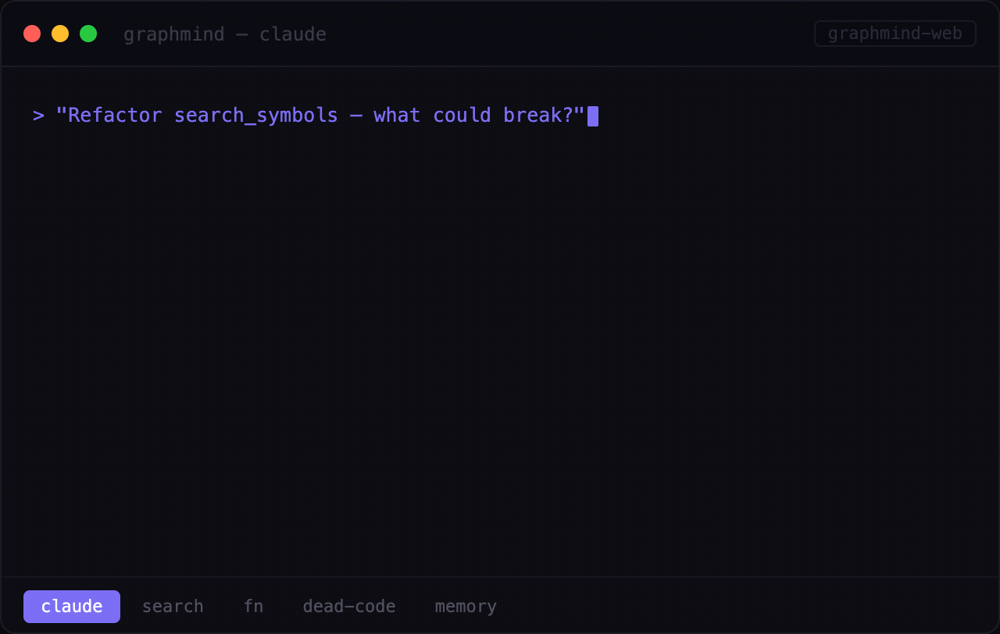
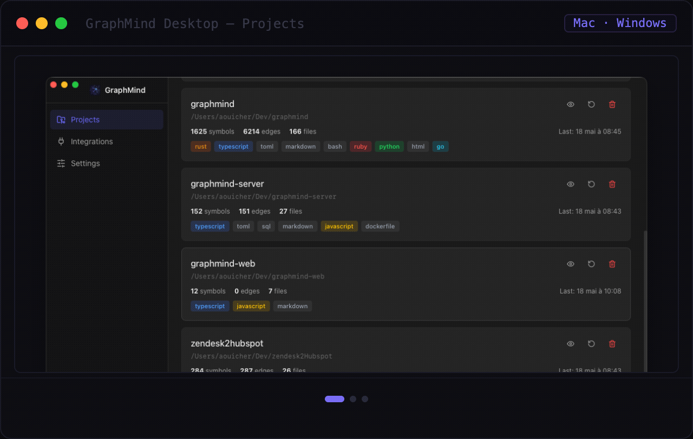
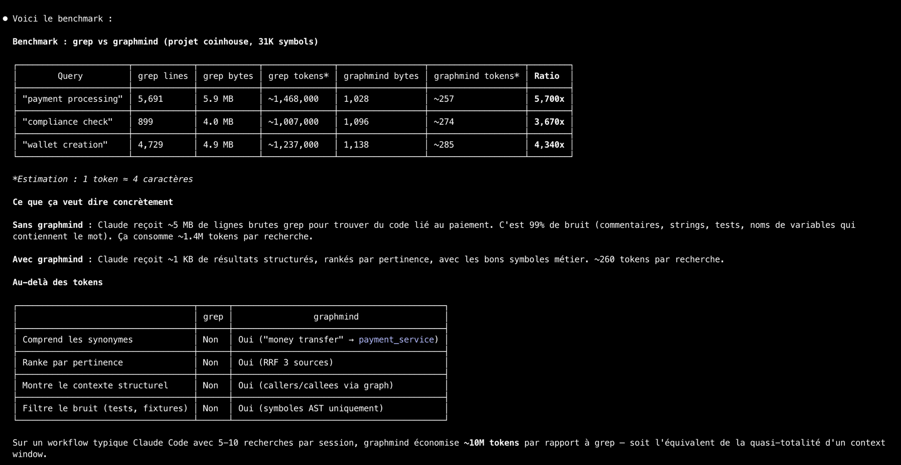
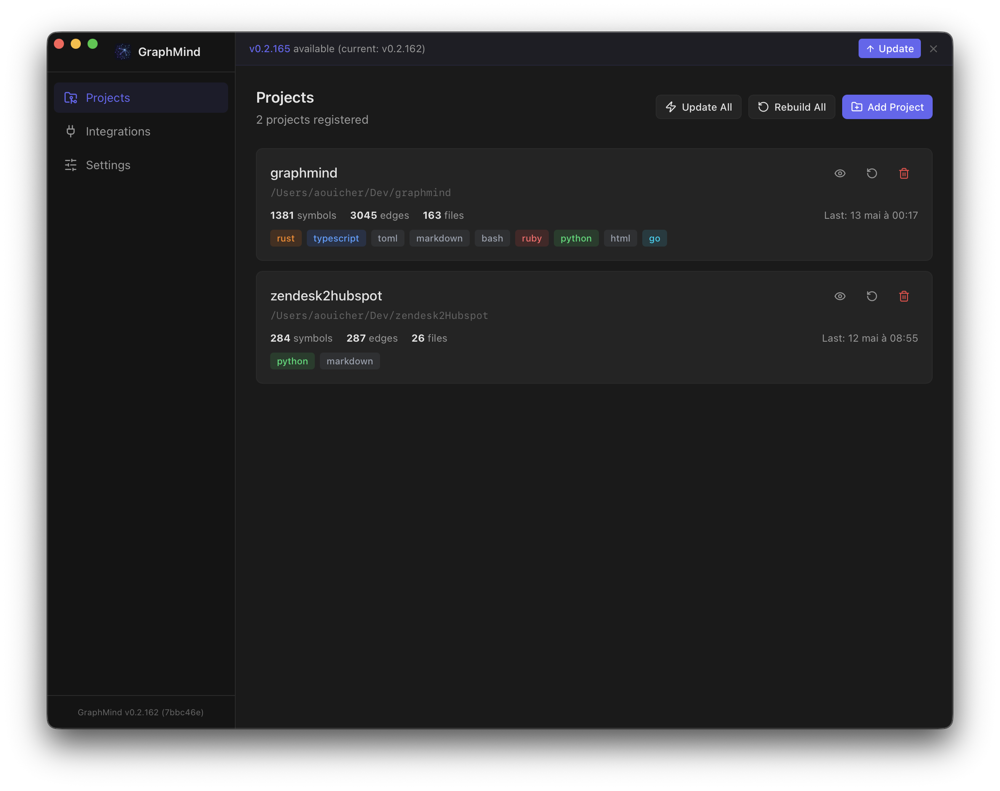

# graphmind

[](https://github.com/aouicher/graphmind/actions/workflows/ci.yml)
[](https://opensource.org/licenses/MIT)

> Your codebase has a shape. Now your AI can see it. And remember it.

GraphMind turns your codebase into a knowledge graph your AI can query, navigate, and remember. Ask about dead code, dependencies, or blast radius — and get answers grounded in your actual architecture.

Up to **5,700× fewer tokens** than raw search (~10M tokens saved per session). Works with Claude Code, Cursor, Windsurf, Cline, Zed, Continue, and any MCP-compatible AI assistant.

<table><tr>
<td></td>
<td></td>
</tr>
<tr>
<td align="center"><sub>CLI + Claude MCP integration</sub></td>
<td align="center"><sub>Desktop app — Mac &amp; Windows</sub></td>
</tr></table>

## Why GraphMind

Every new AI session starts from zero. Your assistant re-reads the entire codebase, re-discovers architecture, and forgets every decision you explained last time. Across multiple projects, there's zero visibility into shared dependencies.

**graphmind** fixes this with four layers:
1. **Structural graph** — function-level knowledge graph per repo (AST-based, tree-sitter, 30+ languages)
2. **Semantic embeddings** — vector search over symbols (local ONNX, OpenAI, or Voyage AI)
3. **Persistent memory** — declarative store for decisions, patterns, conventions — survives across sessions
4. **Cross-project links** — dependencies and relationships between registered repos

Everything runs locally. No cloud. No open ports by default. No telemetry.

## Benchmark



Comparison of token usage: `grep -r` (raw file search) vs `graphmind search` for the same query on a ~100k LOC codebase. graphmind returns ranked, structured results in under 300 tokens vs 1.5M+ for raw grep output.

## Install

### Desktop app (macOS) — recommended

Download the `.dmg` from [Releases](https://github.com/aouicher/graphmind/releases). The app installs the CLI for you and runs a guided onboarding that configures MCP, hooks, skill, and embeddings — no terminal needed.



| Platform | Asset |
|----------|-------|
| macOS (Apple Silicon) | `GraphMind-macos-arm64.dmg` |
| macOS (Intel) | `GraphMind-macos-x64.dmg` |

> **Linux / Windows**: CLI only — use the shell script or direct download below.

### CLI — shell script (macOS/Linux)

```bash
curl -fsSL https://raw.githubusercontent.com/aouicher/graphmind/main/scripts/install.sh | bash
```

Then run `graphmind setup` once to configure Claude Code, hooks, and skill.

### Homebrew (macOS/Linux)

```bash
brew install aouicher/graphmind/graphmind                # CLI
brew install --cask aouicher/graphmind/graphmind         # Desktop app (macOS only)
```

### CLI — Linux (direct download)

```bash
curl -fsSL https://github.com/aouicher/graphmind/releases/latest/download/graphmind-cli-linux-x64 -o ~/.local/bin/graphmind
chmod +x ~/.local/bin/graphmind
```

### From source

```bash
git clone https://github.com/aouicher/graphmind
cd graphmind
cargo build --release -p graphmind-cli
cp target/release/graphmind ~/.local/bin/
```

## Quick Start

```bash
graphmind setup          # once — configures Claude Code, Claude Desktop, hooks, skill
cd ~/projects/myapp
graphmind init           # per project — registers, installs git hooks, builds graph
```

That's it. Claude Code, Claude Desktop, Cursor, and VS Code will use graphmind automatically.

### `graphmind setup` (once, global)

Configures your machine so all AI tools can use graphmind:
1. Shell PATH: when graphmind isn't on PATH yet, one marked line in the profile your shell reads (`~/.zshenv` for zsh, `~/.bashrc` for bash, `~/.profile` otherwise), after a backup of that profile. On Windows, `~/.graphmind/bin` goes on the user PATH and into your PowerShell profile instead. A profile that can't be read as text is left unchanged, and setup prints the folder to add to PATH yourself
2. Claude Code hooks (session context, prompt pre-fetch, and a once-per-session nudge from grep/find searches and Explore agents to graphmind), registered in `~/.claude/settings.json`; a settings.json that can't be read or parsed is left unchanged
3. Claude Code skill (`/gm` + 19 sub-skills)
4. Claude Desktop MCP (`claude_desktop_config.json`; the location per OS is under [Manual setup](#manual-setup-if-you-prefer-granular-control))
5. Claude Code MCP entries, one per repository (`projects.<path>.mcpServers.graphmind` in `~/.claude.json`, or `$CLAUDE_CONFIG_DIR/.claude.json` when that is set, under the path Claude Code reads for the repository, usually its main checkout; see [MCP server for Claude Code](#mcp-server-for-claude-code)): rewrites an entry that points at a moved binary or carries an `env` block, moves an entry earlier versions wrote under a worktree's or a subfolder's own path (which Claude Code never reads) to the repository's, and replaces a user-scope `graphmind` entry that runs graphmind with entries for the registered projects, in one write. Entries are added when a project is registered (`graphmind init`, `graphmind register`, the desktop app); a `.claude.json` that doesn't parse is left as is, and setup runs again later
6. OpenCode MCP (`~/.config/opencode/opencode.jsonc`)
7. Cursor global MCP (`~/.cursor/mcp.json`) — available in all Cursor projects
8. VS Code MCP entries — updates the entry in `.vscode/mcp.json` of registered projects that already have one
9. Git hooks of registered projects — after an upgrade, adds hooks introduced since they were installed (only where graphmind's hooks already are); an existing hook is backed up first, and one that can't be read as text or backed up is left unchanged
10. CLAUDE.md instruction block (`~/.claude/CLAUDE.md`); a block you edited is left as you set it

`setup` re-runs automatically after the binary is updated, when its configuration changed.

### `graphmind init` (per project)

Registers and indexes a project:
1. Registers current directory in the graphmind registry
2. MCP project configs: the Claude Code entry of the project's repository (`projects.<path>.mcpServers.graphmind` in `~/.claude.json`, through `claude mcp add -s local` when the `claude` CLI is on PATH), and VS Code's (`<project>/.vscode/mcp.json`), only in projects that already have a `.vscode/` folder
3. Git hooks (rebuild after commit, merge, rebase and branch switch — new worktrees included; impact check on push)
4. Builds the code graph

```bash
cd ~/projects/api && graphmind init
cd ~/projects/web && graphmind init
cd ~/projects/lib && graphmind init
```

Both commands are idempotent — safe to re-run.

### Using `/gm` outside a project

Claude Code's MCP entries are per repository (see [MCP server for Claude Code](#mcp-server-for-claude-code)), so a session opened outside every registered project has no graphmind MCP tools. `/gm` runs the `graphmind` CLI and works there too: in a session opened outside any indexed project (`graphmind which` prints nothing and exits 1), it still answers questions about a registered project. It runs `graphmind list`, picks the project the question is about (asking you only when several could match), and passes it to every command with `--slug <project>`, for example `graphmind fn dispatch_tool --slug myapp`. Every query command takes `--slug`, except `list` and `cross query`, which span all projects. A slug that isn't registered is an error. Questions about an unregistered folder go to the agent's normal tools.

### Manual setup (if you prefer granular control)

<details>
<summary>Click to expand</summary>

#### MCP server for Claude Code

Claude Code gets graphmind per project, with one entry per repository, under the path Claude Code reads for it when started anywhere in the repository:

- a repository's main checkout, for the checkout, its linked worktrees and their subfolders;
- the bare repository (`repo.git`), for the worktrees of a bare repository;
- the submodule's root, for a submodule and its subfolders, and `<superproject>/.git/modules/<name>` for a worktree of a submodule;
- the work tree's root, for a repository created with `--separate-git-dir`;
- the folder itself, outside git.

- Registering a project (`graphmind init`, `graphmind register`, or adding it in the desktop app) writes or confirms that entry. From a worktree or a subfolder, it says which path it used.
- Unregistering a project removes the entry, unless another registered project uses it. For a project whose folder was deleted, the entry is the graphmind entry under its path or a parent that no registered project uses; when more than one could be, all are left and graphmind says so.
- A `graphmind` entry you set up by hand (its command isn't a graphmind binary) is left alone.
- A `.claude.json` that doesn't parse is left as is and the reason shown; the project is registered anyway.

By hand, in that path (the main checkout, for most repositories):

```bash
claude mcp remove -s local graphmind   # only to replace an existing entry: `claude mcp add` refuses a name that exists
claude mcp add -s local graphmind -- "$(command -v graphmind)" mcp
```

which writes this to `~/.claude.json` (`$CLAUDE_CONFIG_DIR/.claude.json` when that is set), under that path:
```json
{
  "projects": {
    "/home/user/projects/myapp": {
      "mcpServers": {
        "graphmind": {
          "type": "stdio",
          "command": "/home/user/.local/bin/graphmind",
          "args": ["mcp"],
          "env": {}
        }
      }
    }
  }
}
```

The command is the absolute path of your binary. `command -v graphmind` finds it on PATH (`~/.local/bin/graphmind` for the install script, `$(brew --prefix)/bin/graphmind` for Homebrew). `graphmind setup` uses `~/.graphmind/bin/graphmind` instead whenever that file exists (older installs), even when another `graphmind` is first on PATH: pass that path to match it. The empty `env` is fine, but an `env.PATH` there replaces the environment the server inherits, so don't add one.

#### MCP server for Claude Desktop

Claude Desktop does not inherit your shell PATH, so use the full path:

```json
{
  "mcpServers": {
    "graphmind": {
      "command": "/home/user/.local/bin/graphmind",
      "args": ["mcp"]
    }
  }
}
```

Config file location:
- **macOS**: `~/Library/Application Support/Claude/claude_desktop_config.json`
- **Windows**: `%APPDATA%\Claude\claude_desktop_config.json`
- **Linux**: `~/.config/claude/claude_desktop_config.json`

> **Tip**: Run `command -v graphmind` to find the correct path on your system.

#### MCP server for Cursor (global)

`graphmind setup` writes this automatically to `~/.cursor/mcp.json`:
```json
{
  "mcpServers": {
    "graphmind": {
      "command": "/home/user/.local/bin/graphmind",
      "args": ["mcp"]
    }
  }
}
```

#### MCP server for VS Code (per project)

`graphmind init` writes this automatically to `<project>/.vscode/mcp.json`, in projects that already have a `.vscode/` folder:
```json
{
  "servers": {
    "graphmind": {
      "type": "stdio",
      "command": "/home/user/.local/bin/graphmind",
      "args": ["mcp"]
    }
  }
}
```

#### Claude Code search hook

```bash
graphmind install hook-claude
```

Registers hooks in `~/.claude/settings.json` for:
- **PreToolUse** — once per session, reminds Claude to use graphmind when it reaches for grep/rg/find or an Explore agent
- **SessionStart** — loads project context (stats, structure, priority memories) and runs memory upkeep once a day
- **UserPromptSubmit** — pre-fetches relevant memories and code symbols for the user's prompt; priority memories already shown this session are not repeated

Hook output stays under Claude Code's 10,000-character hook limit (longer output is replaced by a short preview), and hooks skip prompts that no person typed (task notifications, messages from other sessions). Re-running `graphmind install hook-claude` or `graphmind setup` removes hooks from older versions.

Built-in intelligence:
- **Exhaustive search bypass** — detects "find all occurrences", `grep -c`, pipes to `wc`/`sort` and lets them through
- **Cache deduplication** — identical searches within 3 minutes are skipped (0 tokens cost)
- **Pattern extraction** — extracts meaningful search terms from grep, find, fd, rg commands and Agent prompts

#### Claude Code skill

```bash
graphmind install skill
```

#### CLAUDE.md sync

```bash
graphmind sync                # updates CLAUDE.md in current project
graphmind sync --all          # updates CLAUDE.md for all registered projects
```

#### Git hooks

```bash
graphmind install hook-git
```

Installs, in the repo's own git dir (shared by all its worktrees):
- **post-commit**, **post-merge**, **post-rewrite** — rebuild the graph in the background after a commit, a pull/merge, a rebase or an amend
- **post-checkout** — reindex the files that changed on a branch switch; on `git worktree add`, register the new worktree and seed its graph
- **pre-push** — print `graphmind diff-impact`

Existing hook scripts are kept (graphmind appends its lines, after a backup). With husky or a `core.hooksPath` outside the repo's git dir, nothing is modified: graphmind prints the lines to add yourself.

</details>

## Git Worktrees & Branches

graphmind is worktree-aware. Each checkout of a repo gets its own code graph,
so answers always describe the branch you are on, while memory (decisions,
conventions, bugs) is shared by all of them: it is repo-wide knowledge.

- **Zero setup for new worktrees**: `git worktree add` (or `claude --worktree`,
  or any graphmind command / MCP call made from a new checkout) registers the
  worktree on the spot. Identity is proven by git (`--git-common-dir`), never
  guessed from names.
- **Nested worktrees**: checkouts inside the main one — Claude Code's
  `.claude/worktrees/<name>` — resolve to themselves, never to the main
  checkout's graph.
- **Fast first build**: a new worktree's graph is copied from the main
  checkout's, then updated incrementally in the background. Only the files
  that differ between the two checkouts get parsed.
- **Shared memory**: a worktree uses its main project's memory file
  (`graphmind list` shows `worktree of <slug>`).
- **Reindex on git activity**: the git hooks (`graphmind install hook-git`,
  run by `graphmind init`) rebuild after commit, merge, rebase and branch
  switch. Hooks live in the repo's git dir, so every worktree gets them.
  Repos using husky or a shared `core.hooksPath` are not modified; graphmind
  prints the lines to add.
- **No silent wrong answers**: from a git repo that is neither registered nor
  a worktree of a registered repo, commands fail with an explicit error
  instead of answering from another project. Outside any git repo, a single
  registered project is still used as before.
- **Claude Code MCP entry**: one per repository, under the main checkout,
  which is where Claude Code reads it in every worktree. `graphmind init` in
  a worktree writes or confirms the main checkout's entry, and a worktree
  never gets an entry of its own.
- **Cleanup**: a worktree registered automatically is forgotten, with its
  graph, once its directory is gone: by the next `graphmind list`,
  `graphmind build --all` or worktree registration. Projects registered by
  hand stay until `graphmind clean --stale`.

### Agents switching worktrees mid-session

An MCP server answers for the checkout it was started in. When an agent moves
into another worktree during a session, it should pass
`project=<absolute path of that worktree>` (or its slug) to graphmind tools;
the server instructions tell agents to do so.

### Upgrading

Nothing to migrate. Existing projects, graphs and memory files are used as
they are; projects registered before worktree support are recognized on
first use. After the upgrade, `graphmind setup` (re-run automatically when
the binary is updated) adds the new git hooks to repos that already have
graphmind's hooks.

## Architecture

```
┌─────────────────────────────────────────────┐
│  Claude Code / MCP Client                    │
├─────────────────────────────────────────────┤
│  MCP Server (rmcp SDK, stdio) — 27 tools     │
│  gm_query · gm_fn · gm_file · gm_deps      │
│  gm_outline · gm_who_calls_chain · gm_dead  │
│  gm_export · gm_similar · gm_listeners      │
│  gm_memory_search · gm_cross_query          │
│  gm_status · gm_context · gm_diff_impact    │
├─────────────────────────────────────────────┤
│  Layer 1: Structural Graph (SQLite + FTS5)   │
│  Symbols · Edges · Call sites                │
├─────────────────────────────────────────────┤
│  Layer 2: Semantic Embeddings (SQLite)       │
│  Cosine search · Graph expansion · RRF      │
├─────────────────────────────────────────────┤
│  Layer 3: Semantic Memory (JSONL)            │
│  Decisions · Patterns · Conventions          │
├─────────────────────────────────────────────┤
│  Layer 4: Cross-Project Links (JSONL)        │
│  Shared symbols · Inferred relationships     │
├─────────────────────────────────────────────┤
│  Rust Core (tree-sitter + napi-rs)           │
│  Multi-language parsing · Symbol extraction  │
└─────────────────────────────────────────────┘
```

## Search & Embeddings

graphmind search combines three retrieval strategies into a single ranked result:

```bash
graphmind search "<query>"          # hybrid search (FTS + semantic + graph)
graphmind search "<q1>; <q2>"       # multi-query with RRF ranking
graphmind search "<query>" --kind function
```

### How search works

1. **FTS5** — exact text matching on symbol names, signatures, docs
2. **Semantic embeddings** — cosine similarity finds conceptually related symbols (e.g. "money transfer" → `payment_service`)
3. **Graph expansion** — top results are expanded with 1-hop callers/callees from the structural graph

Results are fused via Reciprocal Rank Fusion (RRF, k=60). Each result shows its source: `[FTS]`, `[SEM]`, `[GRAPH]`, or combinations like `[FTS+SEM+G]`.

### Embedding providers

Configured in `~/.graphmind/config.json`:

```json
{
  "embedding": {
    "mode": "voyage",
    "model": "voyage-code-3",
    "api_keys": {
      "voyage": "pa-..."
    }
  }
}
```

| Mode | Model (default) | Notes |
|------|----------------|-------|
| `local` | `nomic-embed-text-v1.5` (768d) | ONNX, no API key needed |
| `openai` | `text-embedding-3-small` (1536d) | Supports custom `openai_base_url` |
| `voyage` | `voyage-code-3` (1024d) | Code-specialized, recommended |
| `disabled` | — | No embeddings — **default for new installs** |

Embeddings are computed automatically during `graphmind build` when a provider is configured. If the model changes, the embedding index is rebuilt automatically.

OpenAI-compatible providers (Azure, proxies) can set a custom base URL:
```json
{
  "embedding": {
    "mode": "openai",
    "model": "text-embedding-3-large",
    "openai_base_url": "https://your-proxy.example.com/v1",
    "api_keys": { "openai": "sk-..." }
  }
}
```

## Persistent Memory

graphmind gives Claude persistent memory across sessions — not just code, but decisions, patterns, conventions, and context.

### How it works

Memory is **fully automatic**:
- **Auto-recall** — at each prompt, the hook searches memory for relevant context and injects it into the conversation. No action needed.
- **Auto-save** — Claude proactively saves important facts (decisions, patterns, conventions, bugs, context) without asking. You'll see a brief mention of what was saved.

This works for both **Claude Code** (via hooks) and **Claude Desktop** (via MCP instructions).

### What gets saved

| Type | Examples |
|------|----------|
| `decision` | Architecture choices, tech decisions, trade-off resolutions |
| `pattern` | Recurring approaches, solutions, code patterns |
| `convention` | Naming rules, workflow conventions, style guides |
| `bug` | Known issues, workarounds, gotchas |
| `context` | Business context, project goals, user preferences |

### Storage

Memories are stored as JSONL files in `~/.graphmind/memory/`:
- `global.jsonl` — cross-project knowledge (user preferences, team conventions)
- `<project-slug>.jsonl` — project-specific facts

### Manual control

```bash
graphmind memory add "<fact>" [--slug <slug>] [--global]
graphmind memory search "<query>"
graphmind memory list
graphmind memory delete <id>
```

Memories persist indefinitely until explicitly deleted. They are recalled automatically — you never need to ask "do you remember X?".

## Commands

### Setup & Init
```bash
graphmind setup                   # global one-time (hooks, MCP, skill)
graphmind init [path]             # per-project (register, git hooks, build)
graphmind init --skip-build       # per-project without building
```

### Registry
```bash
graphmind register [path]     # register current dir (and its Claude Code MCP entry)
graphmind unregister <slug>   # remove project (and its Claude Code MCP entry)
graphmind list                # all projects
graphmind status              # health check
```

### Build
```bash
graphmind build [slug]        # incremental build
graphmind build --all         # all projects
graphmind build --full        # force full rebuild
graphmind build --watch       # watch mode (debounced 2s)
graphmind clean [slug]        # remove graph cache (forces full rebuild)
graphmind clean --all         # clean all projects
graphmind clean --stale       # unregister projects whose worktree was removed
```

### Query
```bash
graphmind query <symbol>                          # find symbol + connections
graphmind query <symbol> --file <path>            # filter to a specific file
graphmind query <symbol> --kind function          # filter by kind
graphmind query <symbol> --limit 20 --offset 0   # paginate callers/callees
graphmind fn <symbol>                             # full detail with source + callers/callees
graphmind fn <symbol> --file <path>               # disambiguate by file
graphmind fn <symbol> --kind function             # filter by kind
graphmind fn <symbol> --limit 20 --offset 0      # paginate callers/callees
graphmind fn <symbol> --include-content           # include source code in output
graphmind fn <symbol> --no-tests                  # skip test files
graphmind deps <file>                             # file dependency map
graphmind impact <file>                           # transitive reverse deps
graphmind fn-impact <symbol>                      # blast radius
graphmind diff-impact                             # impact of current git changes
graphmind diff-impact --staged
graphmind map [slug]                              # most-connected files
graphmind cycles [slug]                           # circular dependencies
graphmind outline <file>                          # hierarchical symbol tree for a file
graphmind file <file>                             # raw content of an indexed file, path from project root
graphmind who-calls <symbol>                      # transitive caller chain (BFS)
graphmind who-calls <symbol> --depth 5            # limit traversal depth
graphmind dead-code                               # symbols with no incoming edges
graphmind dead-code --kind function               # filter by kind
graphmind dead-code --limit 50                    # cap results
graphmind similar <symbol>                        # structurally similar symbols
graphmind similar <symbol> --limit 10             # cap results
graphmind listeners <event>                       # find listeners for an event name
```

### Search
```bash
graphmind search "<query>"                        # hybrid FTS + semantic + graph
graphmind search "<q1>; <q2>"                     # multi-query
graphmind search "<query>" --kind class
graphmind search "<query>" --offset 10            # paginate results
graphmind search "<query>" --include-content      # include source code in output
```

### Embeddings
```bash
graphmind embed                     # show embedding index status
graphmind embed --run               # generate embeddings for current project
graphmind embed --run --all         # generate embeddings for all projects
```

### Memory
```bash
graphmind memory add "<fact>" [--slug <slug>] [--global]
graphmind memory search "<query>"
graphmind memory list
graphmind memory delete <id>
```

### Cross-Project
```bash
graphmind cross query <symbol>      # search across ALL projects
graphmind cross deps <slug>         # who depends on this project
graphmind cross links               # all cross-project relationships
graphmind cross link add <a> <b>    # manual link
graphmind cross link infer          # auto-detect shared symbols
```

### Export
```bash
graphmind export [slug] -f dot            # Graphviz dot format
graphmind export [slug] -f mermaid        # Mermaid diagram
graphmind export [slug] -f json           # JSON graph
graphmind export --cross -f mermaid       # cross-project diagram
graphmind export --obsidian ~/vault/      # Obsidian vault with [[wikilinks]]
```

### Exclude
```bash
graphmind exclude list                    # show all patterns
graphmind exclude add grafana-data        # exclude from current project
graphmind exclude add grafana-data --global
graphmind exclude remove grafana-data
```

### Team Sync *(Pro/Team tiers)*

Share your code graph and architectural memories across your team. Every member gets the same structural understanding without re-indexing.

```bash
graphmind team init [--team-id <id>]   # connect to a team
graphmind team push [slug]             # push graph + shared memories
graphmind team push --memories-only    # push memories only
graphmind team push --graph-only       # push graph only
graphmind team push --all              # push all projects
graphmind team pull [slug]             # pull latest from team
graphmind team status                  # sync status per project
```

- **Auto-sync** (Team tier): graph is pushed automatically after each `graphmind build`
- **Memory privacy**: memories marked private (`is_shared: false`) never leave the machine
- **MCP tools**: `gm_team_memories` (shared context) · `gm_team_who_knows` (who documented a symbol)

### Sessions
```bash
graphmind session start [slug]      # log session start
graphmind session save ["message"]  # save session summary
graphmind session history [slug]    # recent sessions
```

### Install / Uninstall
```bash
graphmind install hook-claude     # Claude Code search hook
graphmind install hook-git        # git hooks (rebuild on commit/merge/rebase/checkout, diff-impact on push)
graphmind install skill           # Claude Code skill
graphmind uninstall hook-claude   # remove Claude Code hook
graphmind uninstall hook-git      # remove git hooks
graphmind uninstall all [--purge] [--yes]  # remove ALL integrations (reverse of setup+init); --purge also deletes ~/.graphmind data
graphmind sync [slug]             # inject graph context into CLAUDE.md
graphmind sync --all              # update CLAUDE.md for all projects
```

### Update
```bash
graphmind update                  # download and install latest version
graphmind update --check          # check for updates without installing
```

If installed via Homebrew, use `brew upgrade graphmind` instead. The desktop app also checks for CLI updates at startup and offers one-click update.

## Token Optimization

MCP responses are optimized for LLM consumption — minimal tokens, maximum signal.

**Compact format (default):** One-line-per-symbol text output instead of verbose JSON. Example:
```
>> 5 result(s) for "auth" [FTS+semantic+graph]:

  AuthService [Class] src/services/auth.ts:3 (0.95) [FTS+SEM]
    implements Service
  validate_token [Function] src/services/auth.ts:15 (0.82) [FTS+G]
    (token: string, scope?: string) -> TokenResult
```

**Field pruning:** No `id`, no null signature/doc/content, no redundant `total_found`/`projects_searched` fields. Only useful information is returned.

**Smart limits:** Default 15 results (not 50). Truncation indicators (`+N more...`) shown only when results are capped.

**Content opt-in:** Symbol source code is omitted by default. Pass `include_content: true` to any tool to get it.

**JSON mode:** Pass `format: "json"` to any tool to get structured JSON output instead of compact text.

**Hook cache deduplication:** The Claude Code hook skips duplicate searches within a 5-minute window. Same query → instant skip (0 tokens). Cache is per-session at `/tmp/graphmind-hook-cache.txt`.

## MCP Tools Reference

graphmind exposes 27 tools via MCP (Model Context Protocol):

| Tool | Description |
|------|-------------|
| `gm_query` | Find symbol and its connections |
| `gm_fn` | Function detail with source + callers/callees |
| `gm_deps` | File-level dependency map |
| `gm_impact` | Transitive reverse dependencies |
| `gm_fn_impact` | Blast radius for a symbol |
| `gm_diff_impact` | Impact of current git changes |
| `gm_map` | Most-connected files |
| `gm_cycles` | Circular dependency detection |
| `gm_search` | Hybrid search (FTS + semantic + graph) |
| `gm_listeners` | Find event listeners by event name |
| `gm_outline` | Hierarchical file structure with qualified names |
| `gm_file` | Raw source content of a file, in pages of about 10k tokens (`offset`/`limit` for line ranges) |
| `gm_who_calls_chain` | Transitive caller chain (BFS) |
| `gm_dead_code` | Find symbols with no incoming edges |
| `gm_export` | Export subgraph as Mermaid/DOT |
| `gm_similar` | Find structurally similar symbols |
| `gm_memory_search` | Search stored decisions/patterns |
| `gm_memory_add` | Store a fact (requires confirmation) |
| `gm_memory_list` | List memory entries |
| `gm_memory_update` | Edit a fact in place (keeps its id; a type change can reset the expiry, a demotion the recall count) |
| `gm_session_analyze` | Save several facts at once, skipping near-duplicates |
| `gm_cross_query` | Symbol search across all projects |
| `gm_cross_deps` | Cross-project dependency graph |
| `gm_cross_links` | List all cross-project links |
| `gm_status` | Project health and stats |
| `gm_context` | Full project context for session start |
| `gm_list_projects` | All registered projects |
| `gm_team_memories` | Shared team memories and context *(Pro/Team)* |
| `gm_team_who_knows` | Who documented a given symbol *(Pro/Team)* |

## Security

- **No open ports by default** — MCP uses stdio.
- **Path traversal protection** — all file ops restricted to registered paths + `~/.graphmind/`.
- **No network calls by default** — everything runs locally. Embedding API calls only when explicitly configured. Team sync (Pro/Team tiers) is opt-in and never runs automatically on Free.
- **API keys stored locally** — in `~/.graphmind/config.json`, never sent anywhere except the configured provider.
- **Atomic writes** — memory JSONL writes use tmp+rename to prevent corruption.
- **MCP write confirmation** — `gm_memory_add` requires explicit confirmation.

## Language Support

| Language | Extensions | Status |
|----------|-----------|--------|
| TypeScript | `.ts`, `.tsx` | Stable |
| JavaScript | `.js`, `.jsx`, `.mjs` | Stable |
| Python | `.py` | Stable |
| Go | `.go` | Stable |
| Rust | `.rs` | Stable |
| Ruby | `.rb` | Stable |
| Terraform (HCL) | `.tf`, `.tfvars` | Stable |
| YAML | `.yml`, `.yaml` | Stable |
| Markdown | `.md` | Stable |
| C | `.c`, `.h` | Stable |
| Objective-C | `.m`, `.mm` | Stable |
| Java | `.java` | Stable |
| PHP | `.php` | Stable |
| Swift | `.swift` | Stable |
| Bash | `.sh`, `.bash`, `.zsh` | Stable |
| Perl | `.pl`, `.pm` | Stable |
| CSS | `.css` | Stable |
| SCSS | `.scss`, `.sass` | Stable |
| HTML | `.html`, `.htm` | Stable |
| TOML | `.toml` | Stable |
| Dockerfile | `Dockerfile` | Stable |
| SQL | `.sql` | Stable |
| C++ | `.cpp`, `.cc`, `.cxx`, `.hpp` | Stable |
| C# | `.cs` | Stable |
| Kotlin | `.kt`, `.kts` | Stable |
| Dart | `.dart` | Stable |
| Scala | `.scala`, `.sc` | Stable |
| R | `.r`, `.R` | Stable |
| GraphQL | `.graphql`, `.gql` | Stable |
| PowerShell | `.ps1`, `.psm1` | Stable |

## Data Storage

All data lives in `~/.graphmind/`:
```
~/.graphmind/
├── config.json          # registered projects + embedding settings
├── memory/              # JSONL memory files
├── graphs/<slug>/
│   ├── graph.db         # structural graph (SQLite + FTS5)
│   ├── embeddings.db    # vector embeddings (SQLite)
│   ├── meta.json        # build stats
│   └── cache/           # incremental build cache
├── cross-links/         # cross-project relationships
└── sessions/            # daily session logs
```

Everything is plaintext or SQLite — fully inspectable with standard tools.

## Contributing

Contributions are welcome. graphmind is MIT licensed.

### Setup

```bash
git clone https://github.com/aouicher/graphmind
cd graphmind
cargo build --release -p graphmind-cli
cargo clippy --workspace -- -D warnings
cargo test --workspace
```

### Branch model

| Branch | Purpose |
|--------|---------|
| `main` | Stable, protected. Only maintainers merge here. |
| `feat/<name>` | New features |
| `fix/<name>` | Bug fixes |
| `chore/<name>` | Tooling, deps, CI |

All changes go through a pull request targeting `main`. Direct pushes to `main` are blocked.

### Opening a PR

1. Fork the repo and create a branch from `main`
2. Make your changes — keep commits atomic and descriptive
3. Run `cargo clippy --workspace -- -D warnings` and `cargo test --workspace` — both must pass
4. Open a PR against `main` with a clear description of what and why
5. One maintainer review required before merge

### Tagging and releases

Releases are triggered by pushing a semver tag:

```bash
git tag v0.3.0
git push origin v0.3.0
```

The CI will build binaries for macOS (arm64, x64) and Linux (x64), create a GitHub release, update the Homebrew formula, and publish the Tauri auto-updater manifest — all automatically.

Use `-rc` suffix for pre-releases: `v0.3.0-rc1` (published as pre-release, skipped by Homebrew).

### Reporting issues

Open a [GitHub issue](https://github.com/aouicher/graphmind/issues) with steps to reproduce, your OS, and the output of `graphmind status`.

For security vulnerabilities, see [SECURITY.md](SECURITY.md).
